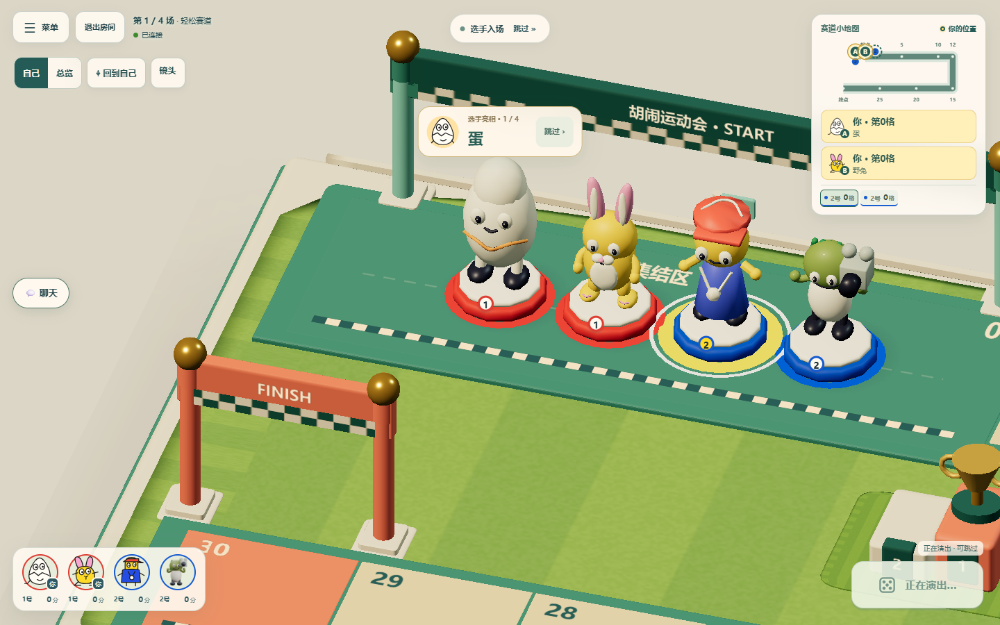
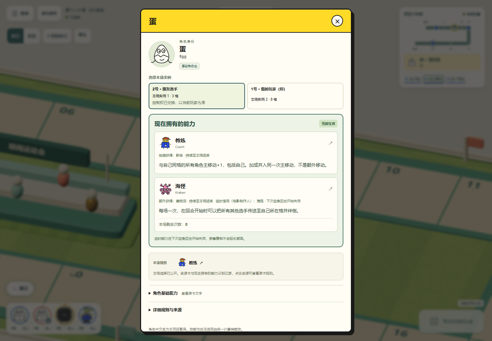
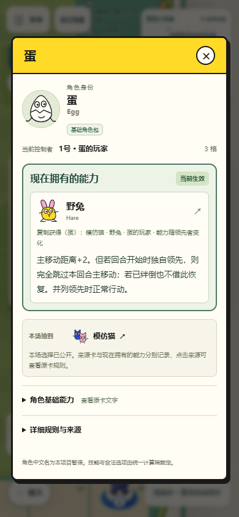

# 能力交互、当前能力详情与获得提示

详情页按照「角色身份 → 当前控制者／实例切换 → 现在拥有的能力 → 抽牌与继承来源 → 原卡及规则来源」排列。

- 头像由 220px 缩至桌面 76px、手机 62px，角色身份不会随复制能力变化。
- 当前能力使用独立主面板，包含能力全文、公开来源、获得方式、期限和剩余次数。同一能力只有一份全文，永久与临时来源可以同时列出。
- 获得或临时借用模仿猫时，同时说明「能力随领先者变化」与外层的失效／本场期限，避免误认为当前解析出的教练等能力会固定整场。
- 只有存在临时来源时才提示「临时能力在下次自身回合开始失效，嵌套复制不会延长期限」。能力失效与展示牌之后何时回弃牌分别处理。
- Null 禁用时保留已拥有的能力列表，并明确标出「暂时禁用／当前未生效」；解除禁用后恢复生效标记。
- 当前真人控制者精简显示。遇到同一角色的多个实例，按稳定的选手 ID 切换；控制权交换后使用当前控制者的信息。
- 蛋抽到的原卡与双胞胎继承来源保留公开链接，避免与当前能力重复大段规则。原卡文字、详细规则和来源默认折叠，图鉴中没有本场实例时直接显示原卡能力。
- 仅使用已公开的能力投影与来源。旧存档没有来源记录时不会猜测抽牌结果或期限。

复制、继承或抽得新能力后，按当次公开事件显示获得者、能力名称、公开来源和期限，保留至少三秒阅读时间；之后可点选手头像查看当前能力。电影制作人的私人抽牌只公开数量，不显示未弃手牌的牌名。重复快照和刷新不重播旧提示。

入场介绍、赛前能力演出和待操作选择现在共用顺序播放队列：先完成介绍，再播放赛前效果，最后显示需要真人处理的选择。跳过介绍只跳过介绍，后续赛前效果仍然播放。此调整只控制本地已确认事件的展示顺序；服务器仍统一结算，不等待所有浏览器的动画确认。重连直接恢复最新确认状态，不重播介绍。

介绍时钟等待每位选手的主模型就绪；加载中的占位不消耗介绍时间，坐骑也不能代替其主模型计数。明确加载失败可使用降级模型，未完成的请求最多等待 12 秒后使用降级占位；用户随时可以跳过介绍。

## 实际网页验证

使用实际 Node 房间服务与 Edge，分别以本人、对手和手机尺寸观战者连接。专项用例在服务端布置公开比赛状态，经过正常房间投影与 WebSocket 展示；并非一场完整比赛的烟测。

`pnpm test:abilities`：316 项通过，覆盖本轮关联规则、公开投影、兼容旧版本、客户端能力详情和演出。最终复核新增的恢复与窗口用例另作定向回归，结果见下方最终检查记录。

`pnpm exec playwright test tests/browser/egg-character-info.spec.ts tests/browser/ability-reveal-intro.spec.ts --trace off`：5 项通过，30.5 秒。覆盖抽牌前后、Copycat 目标变化、刷新恢复、下一场清空、旧存档、Null、临时与永久能力并存、当前控制者、同角色实例切换、手机横向布局，以及入场→赛前效果→待选按钮、获得提示与私手保密。

桌面视口为 1440×1000（入场与提示为 1440×900），手机为 390×844，DPR 1；手机视口使用桌面 Edge，并非实体手机性能测试。本轮未重复八人完整对局。

最终检查：复核修复了旧 v3 的 Filmmaker→Thespian 临时来源恢复，以及 Mush 新获 Copycat 时必须先选择并列领先者再进行未执行主移动的窗口；Leaf 新借 Copycat 同样不复用过期目标缓存。只重跑复制交互专项，38/38 通过。主模型就绪调整后只重跑入场与提示网页专项，1/1 通过（12.3 秒），截图确认四名选手均为真实模型、无失败或加载占位。最终类型检查、两种生产构建及 Worker 打包预演通过；构建仍有既有大包体提示。本轮未部署，远端 CI 以 PR 的 Checks 为准。

规则依据与项目裁定分开列于[复制与临时抽牌裁定](copy-ability-rulings.md)。旧存档如果已丢失历史冠军的准确能力，本轮无法补回丢失信息；不会编造历史来源。

远端首次检查的 320 项关联专项、类型、构建及打包预演通过，4 项详情网页专项通过。入场与提示用例在串行截图后才检查短时提示，软件渲染下错过了三秒展示窗口；改为在两端实际 DOM 出现时记录每个事件，再验证内容、保密和只出现一次。CI 不再额外拍摄成功用例的 QA 截图，失败截图仍保留；本地实际截图照常生成。修正后的唯一受影响用例以 `CI=true` 的软件渲染配置定向运行，1/1 通过（16.8 秒）；未重跑其他本地专项。后续远端结果见 [PR #9 的 Checks](https://github.com/qiuh23/magical-athlete-online/pull/9/checks)。

### 入场：真实模型就绪后开始介绍

### 桌面：永久与临时来源并存

### 手机：复制结果优先，原抽牌保留为来源

### 手机：Null 禁用仍清楚保留已拥有能力

### 获得新能力：当次公开提示

